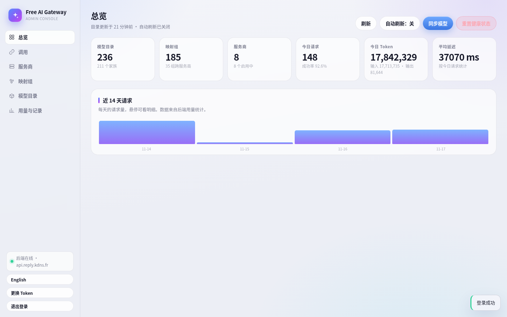
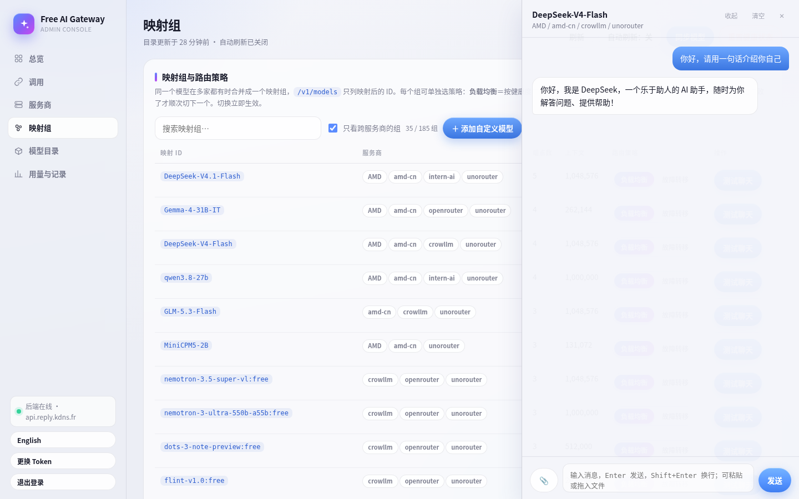
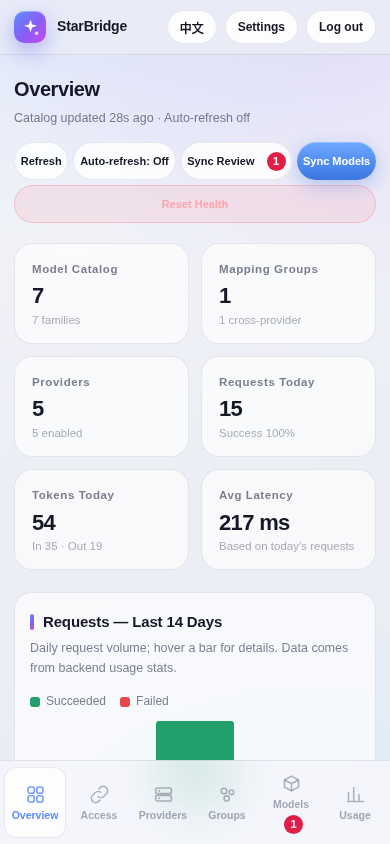
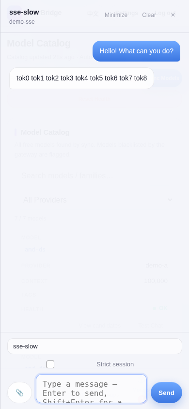

# StarBridge 星桥 (free-ai-gateway)

[中文](README.md)

An AI gateway running on a Cloudflare Worker, compatible with the
OpenAI / Anthropic / Gemini protocols, and serves an MCP endpoint. It aggregates multiple free
upstream model providers behind a single endpoint, maintains a synced
model catalog, and routes each request across providers by health,
with failover and per-key quotas.

- **Backend:** https://api.reply.kdns.fr — model base URL is `https://api.reply.kdns.fr/v1`
- **Admin console:** https://ai.reply.kdns.fr (Cloudflare Pages, source in `frontend/`)

[](https://deploy.workers.cloudflare.com/?url=https://github.com/replycore/free-ai-gateway)

> The one-click button only deploys the backend Worker; bindings,
> secrets and the frontend still need manual setup — see the
> [deployment guide](docs/DEPLOY.en.md) for the full picture.

## Admin console

A tabbed console, switchable between Chinese and English (the choice
is remembered), fully functional on desktop and mobile. Six tabs:
Overview (catalog size, today's requests/tokens/latency, 14-day
trend), Access (base URL, issuing/revoking caller keys with optional
daily limits, plus ready-to-copy connection links and config
snippets per protocol and popular client), Providers (upstreams and their keys, each key can be
enabled/disabled individually), Groups (mapping groups, routing
strategies, custom models), Models (the full synced catalog), and
Usage & Records (per-provider totals and recent request details).

The Overview page ends with an **Operations** section: alert push
(via Bark or a generic webhook when every key of a provider is
unavailable, and again on recovery; checked after failed chat
requests and each catalog sync, at most once per provider per
30 minutes) and config backup (export/import of providers, caller
keys, group strategies and custom models; exports contain
plaintext keys — keep them safe).

Every model in the catalog and in a group opens a **test chat**:
streaming multi-turn conversations with paste/drag file attachments
(images are sent as vision input), a live waiting state with elapsed
time, image-model results rendered as images. The chat can be
minimized into a floating pill — the request keeps running in the
background while you work elsewhere in the console.

<table>
<tr>
<td></td>
<td></td>
</tr>
<tr>
<td></td>
<td></td>
</tr>
</table>

More screenshots: [login](docs/images/console-login.png),
[providers](docs/images/console-providers.png),
[usage & records](docs/images/console-usage.png).

## Endpoints

- `POST /v1/chat/completions`, `GET /v1/models` (OpenAI)

`/v1/models` responses are cached for 10 minutes (in-isolate plus edge
cache). Entries whose id has no vendor prefix (mapping groups and the
`auto` aliases) are listed as `映射组/<name>` so clients that group by
id prefix file them under one folder; the prefix is optional when
calling — both forms route the same.
- `POST /v1/messages`, `POST /v1/messages/count_tokens` (Anthropic)
- `GET /v1beta/models`, `POST /v1beta/models/{model}:generateContent` (Gemini)
- Passthrough: `/v1/audio/*`, `/v1/images/*`, `/v1/embeddings`,
  `/v1/completions`, `/v1/responses`, `/v1/moderations`, `/v1/ocr`,
  `/v1/systemone`
- `GET /healthz`, `GET /` — JSON status only; the Worker serves no pages
- `/admin/api/*` — admin API (below); any other path under `/admin` is a JSON 404

All three protocol entry points behave the same: the Anthropic and
Gemini entries get session stickiness, capability filtering and
failover too, and the gateway's `x-gw-*` response headers pass
through on both. Gemini-shaped error bodies keep their numeric
status code; the gateway error code rides along as `gw_code`.

## How it works

- **Model catalog.** A cron (`13 1,7,13,19 * * *`) syncs every
  provider's model list into a KV-backed catalog and prunes usage
  records older than 90 days. Large catalogs are fetched page by
  page; when a key is rejected by the upstream (401/402/403/429)
  the sync rotates to the next key and only gives up on that
  provider when every key fails. Keys marked invalid are re-probed
  automatically after 24 hours and re-enabled if they recovered —
  no manual intervention. Models are organized into *mapping
  groups* (one public model ID backed by one or more provider
  endpoints) and families; the `auto` alias picks the currently
  most available model per family.
- **Routing.** A Durable Object (`Coordinator`) ranks candidate
  endpoints for every request, weighting configured weight against
  live health: success rate, latency, remaining daily quota, recent
  failures. Each mapping group has its own routing strategy:
  - `balance` (default) — weighted random spread across endpoints;
  - `failover` — a deterministic best-first order that sticks to
    the best endpoint and only moves on when it fails.
  Strategies are stored per group in KV (`cfg:group-strategies:v1`),
  switchable in the console or via `POST /admin/api/groups`.
- **Custom models.** Admins can define their own model IDs with a
  set of keywords: any catalog endpoint whose model name contains
  any keyword (case-insensitive substring match) joins that model.
  Custom models appear in `/v1/models`, work on all three protocol
  entry points, and support per-group routing strategies.
  Definitions live in KV (`cfg:custom-groups:v1`); create/update via
  `POST /admin/api/groups/custom`, delete via
  `DELETE /admin/api/groups/custom?id=…`. IDs colliding with a
  catalog model are rejected; a custom model with no matching
  endpoints yet is shown only in the console.
- **Context-aware routing.** The gateway roughly estimates each
  request's token count (text by characters, images at a fixed
  cost, plus the requested output budget) and prefers endpoints
  whose context window fits. If an upstream still returns a
  context-overflow error, the request fails over to the next
  endpoint instead of failing, until one fits or all are tried.
- **Parameter compatibility.** Parameters an upstream rejects are
  only handled inside a whitelist (`thinking`, `reasoning_effort`
  and similar non-structural fields): the parameter name is read
  from the structured `param` field of the upstream error body
  first, then the same endpoint is retried in-request without it,
  and the endpoint remembers the incompatibility so later requests
  skip the parameter up front. Dropped parameters are reported in
  the `x-gw-dropped-params` response header. Structural fields such
  as `tools` and `stream` are never auto-dropped. Passthrough
  endpoints (embeddings, images, …) have no in-request retry; what
  is learned applies from the next request on.
- **Capability hard filtering.** Requests carrying `tools` hard-
  exclude endpoints known not to support function calling, and
  requests carrying image input hard-exclude endpoints known not
  to support vision (based on provider-published
  `supported_parameters` and input-modality metadata; endpoints
  with no metadata count as unknown and stay routable). If every
  endpoint in the group is known-unsupported, routing degrades to
  all endpoints and says so in the `x-gw-degraded` header
  (`tools` / `vision`).
- **Capability routing.** The model name can state what the request
  needs: `auto:tools`, `auto:vision`, `auto:reasoning`, `auto:json`,
  `auto:image`, combined with `+` (e.g. `auto:tools+vision`) and
  with the ranking aliases (e.g. `auto:fast+tools`). Candidates are
  hard-filtered by the catalog's capability metadata with the same
  semantics as capability hard filtering (known-unsupported is
  excluded, unknown stays routable, an all-known-unsupported pool
  degrades with `x-gw-degraded`); the applied capabilities are
  echoed in the `x-gw-caps` response header.
- **MCP server.** `POST /mcp` is a stateless MCP endpoint
  (Streamable HTTP) authenticated with the same caller key,
  exposing `list_models`, `chat` and `generate_image` tools that
  run through the gateway's own routing and usage accounting.
  MCP-capable clients (such as minis) can use the gateway as a
  tool with the MCP config shown on the console's Access page.
- **Session stickiness.** Consecutive calls of one session stick to
  the same provider endpoint, keeping upstream prompt caches and
  behavior stable. The session is identified by the `x-gw-session`
  header; failing that, the body's `user` field, or — for
  multi-turn conversations (≥3 messages) only — a hash of the
  first 3 messages. Single-turn requests are never inferred. Pins
  live in the Coordinator's durable storage (default 30 minutes,
  tunable via `SESSION_TTL_MS`) and survive Worker restarts; the
  `x-gw-sticky` response header reports `new` or `hit`. If the
  pinned endpoint is unavailable, the request routes normally and
  re-pins to the endpoint that actually served it. For long agent
  sessions, prefer a fixed group name over `auto`: endpoints don't
  drift, so caching and behavior stay stable.
- **Machine-readable errors.** Gateway-generated errors carry a
  stable `code` in the body (`model_not_found`, `no_capacity`,
  `upstream_rate_limited`, `quota_exceeded`,
  `caller_quota_exceeded`, `context_length_exceeded`,
  `key_invalid`, `configuration_error`, …), a `retryable` boolean,
  and — when known to help — `retry_after_ms`, `request_id` and
  `attempts`, so agent clients can branch on `code` instead of
  parsing message text. These codes are a stable contract and are
  never renamed. Anthropic-shaped errors carry the same fields.
- **Recovery hints on no-capacity.** When every candidate is
  unavailable and the gateway returns 503 (`no_capacity`), the
  response gives the earliest recovery time: the `Retry-After`
  header and the body's `retry_after` (seconds) take the earliest
  of all candidates' cooldown / breaker / pause / quota-reset
  times, and `hint` names the actual cause (cooling down, daily
  quota exhausted, key invalid), so agent clients can back off
  intelligently instead of hammering.
- **Circuit breaker and cooldowns.** Transient upstream failures
  (server errors / network / timeouts) count consecutively per
  provider key (across all models) and per model endpoint. At
  `BREAKER_THRESHOLD` (default 3) the key enters a
  `BREAKER_COOLDOWN_MS` (default 5 minutes) cooldown — other
  models sharing that key pause with it; that is the inherent
  cost of per-key breaking. Other outcomes: rate limits cool the
  key for the upstream's stated wait (or 30 s) and briefly pause
  the model; quota errors cool the key until the next UTC+8
  midnight; a 403 cools the key for 1 hour; a 401 marks the key
  invalid (auto re-probed after 24 h); a vanished model disables
  that endpoint for 6 hours. Any success resets the counters.
- **Quotas.** Provider keys carry daily and RPM limits tracked by
  the Coordinator; the quota day is UTC+8 everywhere. RPM is
  counted after the fact, so a burst can overshoot the limit
  slightly for an instant.
- **Caller-key daily quotas.** Console-issued caller keys may carry
  a `dailyLimit` (requests per day, UTC+8 day boundary); exceeding
  it returns 429 `caller_quota_exceeded` with `Retry-After`.
  `GATEWAY_TOKEN` is exempt. Counting happens inside the
  Coordinator's routing decision, with no extra round trip.
- **Per-request retry control.** The `x-gw-max-attempts` header
  overrides the default maximum upstream attempts (default
  `MAX_ATTEMPTS`; the override is clamped between 1 and that
  default). Agent tool loops do well with 2–3, so one failure
  doesn't stall the whole loop.
- **Upstream timeout.** A single 120 s budget
  (`UPSTREAM_TIMEOUT_MS`): for streaming it is the first-byte
  timeout and the no-data idle timeout; for non-streaming it is
  the total limit. Reasoning models that think silently for a very
  long time can still be cut off (some aggregators buffer the
  whole thinking process before streaming anything).
- **Usage accounting.** Every call is recorded in the D1 `usage`
  table (provider, model, key, tokens, latency, status). Writes
  are buffered in the isolate and flushed as one D1 batch every
  20 rows or 4 seconds; admin reads and the cron flush the buffer
  first, and failed batches are re-queued. Streams aborted by the
  client are recorded as `client_abort` and don't pollute the
  endpoint's latency/success statistics. Requests that fail at the
  gateway layer without reaching any upstream (e.g.
  `no_capacity`) are recorded under `gateway`, shown in the
  console as "Gateway itself (never reached upstream)". The table
  is created on first use (`ensureSchema`); `schema.sql` holds
  the same DDL for reference or manual setup.

## Admin API and security model

- One authentication method only: `ADMIN_TOKEN` sent as
  `Authorization: Bearer …`. No query-parameter or cookie auth.
- Browser calls to `/admin/api/*` must come from an origin listed
  in the `ADMIN_ORIGIN` variable (your console domain); any other
  origin, including its preflight, gets 403. When the variable is
  **not configured, all browser requests are rejected**
  (fail-closed); only requests without an `Origin` header (curl,
  scripts) are unaffected. Self-hosters must set it to their own
  console domain.
- Failed admin authentications are counted per client IP in the
  Coordinator: at `ADMIN_AUTH_MAX_FAILS` (default 10) the IP is
  locked out for `ADMIN_AUTH_LOCKOUT_MS` (default 15 minutes),
  during which even the correct token gets `429` + `Retry-After`.
  A successful login resets the counter; if the Coordinator is
  unreachable the throttle fails open, while token verification
  itself still applies.
- Provider API keys are stored AES-GCM-encrypted under
  `MASTER_KEY`; the admin API only ever returns masks. If the
  master key is missing or corrupt, operations that need
  decryption return 503 `configuration_error` instead of silently
  using a wrong key. Provider IDs are validated on write:
  letters, digits and `._-`, at most 40 characters.
- Callers authenticate with `GATEWAY_TOKEN`, or with a caller key
  issued in the console's Access tab (individually revocable, may
  carry a daily limit).
- Main routes: `GET /admin/api/overview`, `/providers` (GET/POST,
  `/providers/{id}`, `/providers/{id}/keys`, with
  `PATCH /providers/{id}/keys/{keyId}` toggling a single key's
  enabled state), `/gateway-keys`, `/groups` (GET/POST),
  `/groups/custom`, `/catalog`, `/stats`, and `POST /sync`,
  `/probe`, `/reset`.

## Layout

- `src/` — the backend Worker as ES modules; the entry is
  `src/index.js`, the rest is split by responsibility (`router`
  for routing and dispatch, `coordinator` for health state and
  ranking, `adapters/` for upstream protocols, `anthropic-in` /
  `gemini-in` for inbound protocol translation, `admin` for the
  admin API, …). Wrangler bundles it at deploy time; no manual
  build step.
- `wrangler.toml` — bindings, variables and cron configuration;
  contains no secrets.
- `schema.sql` — the DDL for the D1 `usage` table (reference; the
  Worker also creates it automatically).
- `frontend/` — the admin console (static site + a Pages Function
  middleware), deployed to the Pages project
  `free-ai-gateway-admin`. All UI copy goes through a string
  dictionary; Chinese / English switchable and remembered. The
  backend address comes only from the `GW_API_BASE` deployment
  variable (injected via `/config.json`); there is no hardcoded
  or fallback backend address anywhere in the code, and when the
  configuration is missing the login page says so instead of
  sending the token anywhere. Security headers such as the CSP
  are generated by the middleware from `GW_API_BASE`.
- `docs/` — the [deployment guide](docs/DEPLOY.en.md)
  ([中文](docs/DEPLOY.md)): every deployment route for both parts
  (including dashboard-UI walkthroughs), the full variable tables
  and the post-deploy checklist; `docs/images/` holds the console
  screenshots used above.
- `tests/` — local verification scripts (mock upstreams, the
  regression suite, browser tests) used with `wrangler dev`; each
  file explains itself at the top.
- `package.json` — the usual command scripts (below).
- `.dev.vars.example` — the local-dev secrets template; copy it to
  `.dev.vars` (gitignored — never commit real secrets).

## Configuration at a glance

Bindings (see `wrangler.toml`): D1 `DB`, KV `GW_KV`, Durable
Object `COORD` (class `Coordinator`).

Secrets (Cloudflare `secret_text`, never in the repo):

```bash
wrangler secret put ADMIN_TOKEN     # admin console / admin API
wrangler secret put GATEWAY_TOKEN   # built-in caller token
wrangler secret put MASTER_KEY      # encrypts provider keys (32-byte base64)
```

Plain variables live in `wrangler.toml`'s `[vars]` with comments:
`ADMIN_ORIGIN`, `DEFAULT_ALIAS`, `KEEP_PER_FAMILY`, `MAX_ATTEMPTS`,
`MODEL_GROUPING`, `PROBE_PER_SYNC`, `SYNC_ENABLED`,
`UPSTREAM_TIMEOUT_MS`, plus the breaker / login-throttle /
session parameters mentioned above. Meanings and defaults are in
[the deployment guide's variable tables](docs/DEPLOY.en.md#3-variable-reference).

The Pages side needs exactly one variable: `GW_API_BASE` (the
backend's full address), served to the frontend by a Pages Function
via `/config.json`.

## Local development

```bash
npm install
cp .dev.vars.example .dev.vars   # local dummy tokens are fine
npm run dev                      # backend http://127.0.0.1:8787
npm run dev:ui                   # frontend http://127.0.0.1:8788 (bound to the local backend)

# trigger the cron handler manually
curl "http://127.0.0.1:8787/cdn-cgi/local/scheduled"
```

## Deployment

```bash
npm run deploy       # backend: wrangler deploy from the repo root
npm run deploy:ui    # frontend: the script cds into frontend/ first
                     # (deploying Pages from the root silently drops
                     # the Functions bundle and /config.json breaks)
```

For a first deployment — creating D1 / KV, setting secrets, the
one-click button, Git integration, and full dashboard-UI
walkthroughs — see the [deployment guide](docs/DEPLOY.en.md).
