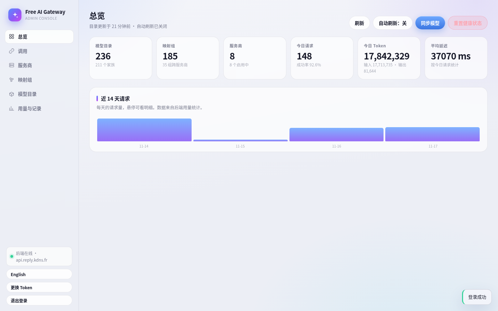

# 星桥 StarBridge（free-ai-gateway）

[English](README.en.md)

一个跑在 Cloudflare Worker 上的 AI 网关，兼容 OpenAI / Anthropic /
Gemini 三种协议，并提供 MCP 服务端点。它把多家上游免费模型服务商聚合到一个端点后面，维护
一份同步的模型目录，并按健康度为每个请求在多个服务商之间排序、故障
转移，带每 Key 配额。

- **后端：** https://api.reply.kdns.fr — 模型 Base URL 为 `https://api.reply.kdns.fr/v1`
- **管理后台：** https://ai.reply.kdns.fr（Cloudflare Pages，源码在 `frontend/`）

[](https://deploy.workers.cloudflare.com/?url=https://github.com/replycore/free-ai-gateway)

> 一键按钮只部署后端 Worker，且绑定、密钥、前端都要再手动补齐——
> 完整说明见 [部署指南](docs/DEPLOY.md)。

## 管理后台

标签页式控制台，中英文界面可切换并记住选择，桌面与移动端都是完整
功能。六个标签：总览（目录规模、当日请求/Token/延迟、近 14 天趋势）、
调用（Base URL、调用 Key 的签发/撤销/每日限额，以及按协议和常用客户端整理好、可一键复制的调用链接与配置示例）、服务商（上游与
Key 管理，Key 可单独启用/停用）、映射组（分组与路由策略、自定义
模型）、模型目录（同步到的全部模型）、用量与记录（按服务商统计与
最近请求明细）。

总览页底部有**运维**区：告警推送（服务商全部 Key 不可用或恢复时，
经 Bark 或通用 Webhook 推送，在聊天或透传失败与目录同步后检查、30 分钟内
不重复推送同一服务商）和配置备份（导出/导入服务商、调用 Key、分组
策略与自定义模型；导出文件含明文 Key，需妥善保管）。

目录与映射组里的每个模型都能直接打开**测试聊天**：流式多轮对话，
可粘贴/拖入文件附件（图片按视觉输入发送，文本文件内嵌进消息，
PDF 等其它文件以文件附件发送），等待时有实时状态与计时，
图片模型的结果直接渲染成图；窗口可以收起成悬浮条，请求在后台继续，
做别的操作不会中断它。

<table>
<tr>
<td></td>
<td></td>
</tr>
<tr>
<td></td>
<td></td>
</tr>
</table>

更多截图：[登录页](docs/images/console-login.png)、
[服务商](docs/images/console-providers.png)、
[用量与记录](docs/images/console-usage.png)。

## 接口

- `POST /v1/chat/completions`、`GET /v1/models`、`GET /v1/models/{id}`（OpenAI）

`/v1/models` 的结果带 10 分钟缓存（内存 + 边缘各一层）。列表中不带厂商
前缀的条目里，映射组与 `auto` 别名写作 `映射组/<名称>`，方便按
前缀分组的客户端归类；只有一家服务商的模型直接用原名（归属见
`owned_by`），不加这个前缀。调用时带不带前缀都可以。
- `POST /v1/messages`、`POST /v1/messages/count_tokens`（Anthropic）
- `GET /v1beta/models`、`POST /v1beta/models/{model}:generateContent`、`POST /v1beta/models/{model}:streamGenerateContent`（Gemini）
- 透传：`/v1/audio/speech`、`/v1/audio/transcriptions`、
  `/v1/audio/translations`、`/v1/images/generations`、
  `/v1/images/edits`、`/v1/embeddings`、
  `/v1/completions`、`/v1/responses`、`/v1/moderations`、`/v1/ocr`、
  `/v1/systemone`
- `GET /healthz`、`GET /` — 只返回 JSON 状态；Worker 不提供任何页面
- `/admin/api/*` — 管理 API（见下）；`/admin` 下的其它路径一律 JSON 404

三种兼容接口的行为一致：Anthropic / Gemini 入口同样享受会话粘滞、
能力过滤与失败转移，网关的 `x-gw-*` 响应头会透传到这两个入口；
Gemini 形状的错误正文保留数字状态码，网关错误码放在 `gw_code` 字段。
成功响应还会带 `x-gw-provider`、`x-gw-model`、`x-gw-group`、
`x-gw-strategy`、`x-gw-request-id`、`x-gw-attempts` 等响应头，
标明实际命中的端点、分组与尝试次数。为兼容官方 Gemini SDK，
Gemini 入口除 `x-goog-api-key` 请求头外也接受 `?key=` 查询参数
传 Key；查询参数会出现在 URL 里，可能被日志记录，介意时请改用
请求头方式。

## 工作方式

- **模型目录。** cron（`13 1,7,13,19 * * *`）把每个服务商的模型列表
  同步进 KV 里的目录，并清理 90 天前的用量记录。同步按页拉取大目录，
  某把 Key 被上游拒绝（401/402/403/429）时自动换下一把继续，全部
  失败才放弃该服务商这一轮；被标失效的 Key 会在 24 小时后自动解除标记，
  由下一次真实请求决定是否可用，不必人工干预。模型被组织成*映射组*（一个对外
  模型 ID 背后挂两个或以上服务商的端点；只有一家服务商的模型
  直接按原名进目录）和家族，`auto` 别名会为每个
  家族挑当前最可用的模型。
- **路由。** 一个 Durable Object（`Coordinator`）为每个请求给候选
  端点排序，权重综合配置权重与实时健康度：成功率、延迟、每日剩余额度、
  近期失败。每个映射组有自己的路由策略：
  - `balance`（默认）— 按权重随机分摊到各端点；
  - `failover` — 确定性的最优优先顺序，粘住最优端点，它失败了才换下一个。
  策略按组存在 KV（`cfg:group-strategies:v1`），可在管理后台切换，
  或用 `POST /admin/api/groups` 设置。
- **自定义模型。** 管理员可以定义自己的模型 ID 并配一组关键词：
  目录里模型名包含任一关键词（不区分大小写、子串匹配）的端点
  自动归入该模型，出现在 `/v1/models` 中，可被三种兼容接口调用，
  同样支持按组路由策略。定义存在 KV（`cfg:custom-groups:v1`），
  用 `POST /admin/api/groups/custom` 创建/更新、
  `DELETE /admin/api/groups/custom?id=…` 删除；与目录模型重名的
  ID 会被拒绝，暂时匹配不到端点的自定义模型只在后台列表中显示。
- **上下文感知路由。** 网关会粗略估算每个请求的 token 数（文本按
  字符估算、图片按固定值、再加上请求的输出预算），优先把请求发给
  上下文窗口装得下的端点；若上游仍返回上下文超限错误，不再直接
  失败，而是自动换下一个端点重试，直到有端点装得下或全部试完。
- **参数兼容。** 因上游不支持而被拒绝的请求参数，只在白名单
  （`thinking`、`reasoning_effort` 等非结构字段）内处理：参数名优先
  从上游错误正文的结构化 `param` 字段读取，识别后会在同一次请求
  内立即去掉该参数重试当前端点，并记住该端点不支持这个参数，
  后续请求直接避开；被丢弃的参数通过响应头 `x-gw-dropped-params`
  标明。`tools`、`stream` 等结构字段永远不会被自动丢弃。透传类
  接口（embeddings、images 等）没有同请求重试，学到的参数兼容性
  从下一次请求起生效。
- **能力硬过滤。** 带 `tools` 的请求会硬性排除已知不支持
  function calling 的端点，带图片输入的请求会硬性排除已知不支持
  视觉的端点（依据服务商公布的 `supported_parameters` 与输入模态
  元数据；元数据没提的端点视为未知、照常可路由）。若组内端点全都
  已知不支持，则降级为全部照常路由，并在响应头 `x-gw-degraded`
  里标明（`tools` / `vision`）。
- **能力路由。** 模型名可以直接写需求：`auto:tools`、`auto:vision`、
  `auto:reasoning`、`auto:json`、`auto:image`，用 `+` 组合多项
  （如 `auto:tools+vision`），也可与排序别名组合（如
  `auto:fast+tools`）。网关按目录里的能力元数据硬过滤候选，语义与
  能力硬过滤一致（已知不支持才排除，未知照常可路由，全员已知不
  支持时降级并标 `x-gw-degraded`），命中的能力写在响应头
  `x-gw-caps` 里。
- **MCP 服务。** `POST /mcp` 是无状态的 MCP（Streamable HTTP）
  端点，用同一个调用 Key 鉴权，提供 `list_models`、`chat`、
  `generate_image` 三个工具，工具内部走网关自身的路由与记账；
  支持 MCP 的客户端（如 minis）填入管理台「调用」页给出的 MCP
  配置即可把网关当作工具使用。
- **会话粘滞。** 同一会话的连续调用会固定到同一个服务商端点，让
  上游的 prompt 缓存和行为保持稳定。会话由请求头 `x-gw-session`
  标识；没传时用请求体的 `user` 字段，或对多轮对话（≥3 条消息）
  用前 3 条消息的哈希推断，单轮请求不推断。固定关系存在
  Coordinator 的持久化存储里（默认 30 分钟，`SESSION_TTL_MS` 可调），
  Worker 重启不丢失；响应头 `x-gw-sticky` 标明本次是新建固定
  （`new`）还是命中已有固定（`hit`）。被固定的端点不可用时自动
  按正常排序路由，并在成功后改固定到实际用的端点。给 agent 的
  长会话建议固定使用组名而不是 `auto`，端点不漂移，缓存和行为
  才稳定。
- **机器可读错误。** 网关自己生成的错误在正文里带稳定的
  `code`（如 `model_not_found`、`no_capacity`、
  `upstream_rate_limited`、`quota_exceeded`、`caller_quota_exceeded`、
  `context_length_exceeded`、`key_invalid`、`configuration_error`
  等）、`retryable` 布尔值，以及已知有帮助时的 `retry_after_ms`、
  `request_id` 和 `attempts`，agent 客户端可以按 `code` 分支处理，
  不必解析 message 文本。这些 `code` 是稳定契约，不会改名。
  Anthropic 形状的错误也会带上这些字段。
- **无容量时的恢复提示。** 当所有候选都不可用返回 503（`no_capacity`）时，
  响应会给出最早恢复时间：`Retry-After` 头和正文的 `retry_after`
  （秒）取各候选冷却 / 熔断 / 暂停 / 额度重置中最早的一个，
  `hint` 也按实际原因（冷却中 / 每日额度用完 / Key 失效）说明，
  方便 agent 客户端按提示退避重试，而不是盲目撞墙。
- **熔断与冷却。** 上游的瞬时失败（服务器错误 / 网络 / 超时）按
  服务商 Key（跨全部模型）和按模型端点分别累计连续次数；达到
  `BREAKER_THRESHOLD`（默认 3）后，该 Key 进入
  `BREAKER_COOLDOWN_MS`（默认 5 分钟）冷却——同一把 Key 上的其它
  模型会一起暂停，这是按 Key 熔断的固有代价。其它处置：限流按
  上游给的等待时间（或 30 秒）冷却该 Key 并短暂暂停该模型；额度
  错误把该 Key 冷却到下一个 UTC+8 午夜；403 冷却 1 小时；401 把
  Key 标失效（24 小时后自动解除标记）；模型不存在则该端点停用 6 小时。
  任意一次成功会清零对应计数。
- **配额。** 服务商 Key 带每日上限和 RPM 上限，由 Coordinator
  跟踪，日界统一按 UTC+8。RPM 是事后计数，突发瞬间可能小幅
  超过上限。
- **调用 Key 日额度。** 后台签发的调用 Key 可带 `dailyLimit`
  （每日请求数上限，按 UTC+8 日界）；超限返回 429
  `caller_quota_exceeded` 并带 `Retry-After`。`GATEWAY_TOKEN`
  不受此限。计数在 Coordinator 的路由判定里一并完成，不额外
  增加往返；请求在路由阶段因无可用候选被拒时不计数。撤销或
  删除调用 Key 后，各 isolate 的配置缓存最迟 60 秒完成一次
  重验证，撤销最迟 60 秒在全网生效。
- **请求级重试控制。** 请求头 `x-gw-max-attempts` 可覆盖默认的
  最大上游尝试次数（默认 `MAX_ATTEMPTS`；正数覆盖值会被钳制在
  1 与该默认值之间，0、负数与非数字会被忽略、直接用默认值）；
  agent 的工具循环建议设 2~3，避免一次失败
  卡住整个循环。
- **上游超时。** 统一 120 秒（`UPSTREAM_TIMEOUT_MS`）：流式是
  首字节超时与无数据断流超时，非流式是总时长上限。会长时间静默
  思考的推理模型仍可能被切断（有些聚合商会把整个思考过程缓冲完
  才开始吐流）。
- **用量记账。** 每次调用都记入 D1 的 `usage` 表（服务商、模型、
  Key、Token、延迟、状态）。写入先在 isolate 里缓冲，攒满 20 条或
  4 秒后以一次 D1 batch 落库；管理端读取和 cron 会先把缓冲刷完，
  写失败的批次会重新排队。客户端中途断开的流式请求按
  `client_abort` 记账，不污染端点的延迟/成功率统计。失败的请求
  记在实际涉及的服务商名下（只涉及一家时就是那家）；只有横跨
  一个映射组多家服务商的失败才记在 `gateway` 名下，后台用量页
  显示为「网关映射」，按服务商汇总的表里不会出现网关这一行。
  内容过滤拒绝和调用 Key 额度超限也会记账；透传接口每次请求只
  记一行。
  表在首次使用时自动创建（`ensureSchema`），`schema.sql` 里是
  同一份 DDL，供参考或手动建表。

## 管理 API 与安全模型

- 认证只有一种：`ADMIN_TOKEN` 以 `Authorization: Bearer …` 发送。
  没有 query 参数或 cookie 认证。
- 浏览器对 `/admin/api/*` 的调用必须来自 `ADMIN_ORIGIN` 变量列出的
  来源（控制台域名），其它来源连同其预检请求一律 403。这个变量
  **没有配置时是全拒绝**（fail-closed）：浏览器请求一律 403，只有
  没有 `Origin` 头的请求（curl、脚本）不受影响。自部署时务必把
  自己的控制台域名填上。
- 管理端认证失败按客户端 IP 在 Coordinator 里计数：达到
  `ADMIN_AUTH_MAX_FAILS`（默认 10 次）后该 IP 被锁定
  `ADMIN_AUTH_LOCKOUT_MS`（默认 15 分钟），期间即使 token 正确也
  返回 `429` + `Retry-After`。登录成功会清零计数；Coordinator
  不可达时节流放行（fail-open），token 校验本身照常。
- 服务商 API Key 用 `MASTER_KEY` 做 AES-GCM 加密存储，管理 API
  只返回掩码。主密钥缺失或损坏时，涉及解密的操作返回 503
  `configuration_error`，不会静默用错钥匙。服务商 id 只允许
  首字符必须是字母或数字，其余可含字母、数字与 `._-`
  （总长最长 40 字符），在写入时校验。
- 调用方用 `GATEWAY_TOKEN`，或在后台「调用」里签发的调用 Key
  （可单独撤销、可带每日限额）认证。
- 主要路由：`GET /admin/api/overview`、`/providers`（GET/POST、
  `/providers/{id}`（含 DELETE 删除服务商）、
  `/providers/{id}/keys`（POST 加 Key），其中
  `PATCH /providers/{id}/keys/{keyId}` 切换单把 Key 的启用状态、
  `DELETE /providers/{id}/keys/{keyId}` 删除该 Key）、
  `/gateway-keys`（含 `DELETE /gateway-keys/{id}`）、
  `/groups`（GET/POST）、`/groups/custom`、
  `/catalog`、`/stats`、`/alerts`（GET/PUT 与 `POST /alerts/test`）、
  `/export`、`/import`，`POST /sync`、`/probe`、`/reset`。

## 仓库结构

- `src/` — 后端 Worker 的模块化源码（ES modules），入口是
  `src/index.js`，其余模块按职责拆分（`router` 路由与调度、
  `coordinator` 健康状态与排序、`adapters/` 上游协议适配、
  `anthropic-in` / `gemini-in` 入口协议翻译、`admin` 管理 API 等）；
  wrangler 部署时自动打包，无需手动构建。
- `wrangler.toml` — 绑定、变量、cron 配置，不含任何密钥。
- `schema.sql` — D1 `usage` 表的 DDL（参考；Worker 也会自动建表）。
- `frontend/` — 管理后台（静态站 + Pages Function 中间件），部署到
  Pages 项目 `free-ai-gateway-admin`；界面文案全部走词条字典，
  中文 / English 可切换并记住选择；后端地址只来自部署变量
  `GW_API_BASE`（经 `/config.json` 注入），代码里没有任何写死或
  回退的后端地址，配置缺失时登录页会明确报错而不是把 Token
  发往别处；CSP 等安全响应头由中间件按 `GW_API_BASE` 动态生成。
- `docs/` — [部署指南](docs/DEPLOY.md)（[English](docs/DEPLOY.en.md)）：
  前后端的各种部署方式（含控制台界面操作）、完整变量表和部署后
  清单；`docs/images/` 是本文用到的控制台截图。
- `tests/` — 本地验证脚本（mock 上游、回归测试、浏览器测试），
  配合 `wrangler dev` 使用；每个文件头部有说明。
- `package.json` — 常用命令脚本（见下）。
- `.dev.vars.example` — 本地开发密钥模板，复制为 `.dev.vars` 使用
  （`.dev.vars` 已被 gitignore，永远不要提交真实密钥）。

## 配置速览

绑定（见 `wrangler.toml`）：D1 `DB`、KV `GW_KV`、Durable Object
`COORD`（类 `Coordinator`）。

密钥（Cloudflare `secret_text`，不进仓库）：

```bash
wrangler secret put ADMIN_TOKEN     # 管理后台 / 管理 API
wrangler secret put GATEWAY_TOKEN   # 内置调用方 Token
wrangler secret put MASTER_KEY      # 加密服务商 Key（32 字节 base64）
```

普通变量都在 `wrangler.toml` 的 `[vars]` 里并带注释：`ADMIN_ORIGIN`、
`DEFAULT_ALIAS`、`KEEP_PER_FAMILY`、`MAX_ATTEMPTS`、`MODEL_GROUPING`、
`PROBE_PER_SYNC`、`SYNC_ENABLED`、`UPSTREAM_TIMEOUT_MS`，以及上面
提到的熔断 / 登录节流 / 会话粘滞参数。每项的含义和默认值见
[部署指南的变量总表](docs/DEPLOY.md#3-变量设置总表)。

Pages 侧只需要一个变量：`GW_API_BASE`（后端完整地址），由 Pages
Function 通过 `/config.json` 提供给前端。

## 本地开发

```bash
npm install
cp .dev.vars.example .dev.vars   # 填本地假 token 即可
npm run dev                      # 后端 http://127.0.0.1:8787
npm run dev:ui                   # 前端 http://127.0.0.1:8788（已绑定本地后端地址）

# 手动触发一次 cron 处理
curl "http://127.0.0.1:8787/cdn-cgi/local/scheduled"
```

## 部署

```bash
npm run deploy       # 后端：仓库根目录执行 wrangler deploy
npm run deploy:ui    # 前端：脚本会进入 frontend/ 再部署（从根目录直接
                     # 部署 Pages 会漏掉 Functions 包，/config.json 会失效）
```

第一次部署（含创建 D1 / KV、设置密钥、一键部署按钮、Git 集成、
控制台界面手动部署等全部方式）请看 [部署指南](docs/DEPLOY.md)。
