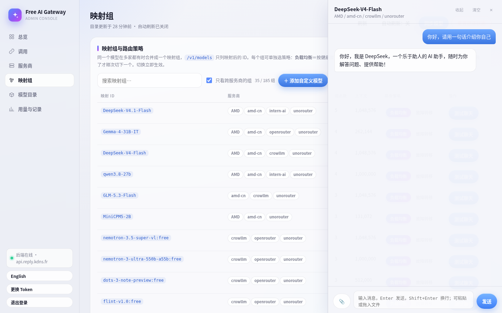
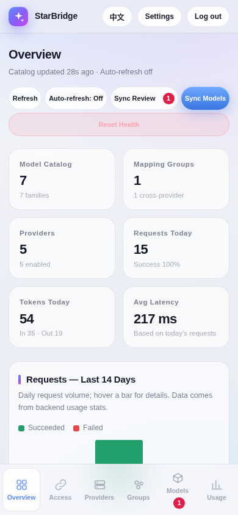
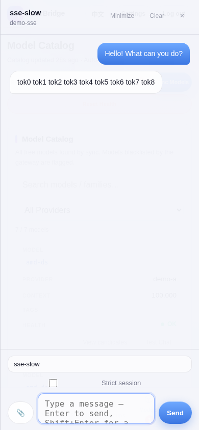

# 星桥 StarBridge

[English](README.en.md)

一个跑在 Cloudflare Worker 上的 AI 网关：把多家免费 AI 服务商聚到一个地址后面，用 OpenAI、Anthropic、Gemini 三种方式调用，配一个网页管理后台。

[](https://deploy.workers.cloudflare.com/?url=https://github.com/replycore/StarBridge)

> 一键按钮只部署后端 Worker，绑定、密钥和前端还要再补齐——完整步骤见[部署指南](docs/DEPLOY.md)。

## 快速开始

1. 按[部署指南](docs/DEPLOY.md)把后端（Worker）和前端（Pages 管理后台）部署好。
2. 打开管理后台，用 `ADMIN_TOKEN` 登录。
3. 在「服务商」里添加上游服务商和它的 Key。
4. 点顶栏的「同步模型」，把模型目录拉下来。
5. 在「模型目录」或「映射组」里点任意模型的「测试聊天」，能聊就是通了；也可以在「调用」页复制 Base URL 和 Key，填进你的客户端。

顺序不能反：没有服务商时同步跑不出任何模型。

## 管理后台

中英文界面可切换，桌面和手机都能用。六个标签：

- **总览**：模型数量、当天请求和 Token、最近 14 天的成功/失败趋势，底部是告警和备份。
- **调用**：Base URL、调用 Key 的签发和撤销、按客户端整理好的配置示例。
- **服务商**：上游服务商和 Key 的管理，Key 可以单独启用或停用。
- **映射组**：同名模型在多家服务商之间的分组和路由策略，还能添加自定义模型。
- **模型目录**：同步到的全部模型，每个都能直接打开测试聊天。
- **用量**：按服务商统计的用量和最近请求的明细，失败行可以展开看原因。

<table>
<tr>
<td></td>
<td></td>
</tr>
<tr>
<td></td>
<td></td>
</tr>
</table>

更多截图：[登录页](docs/images/console-login.png)、
[服务商](docs/images/console-providers.png)、
[映射组](docs/images/console-groups.png)、
[模型目录](docs/images/console-models.png)、
[同步待审](docs/images/console-syncreview.png)、
[设置](docs/images/console-settings.png)、
[用量](docs/images/console-usage.png)。

## 日常操作

### 同步模型

顶栏「同步模型」会重新拉取每个服务商的模型列表。平时不用手动点，每天会自动同步四次。

### 同步待审

某个模型连续两次同步都没出现时，它不会直接消失，而是进顶栏「同步待审」的弹窗：可以确认删除、恢复，或忽略。7 天没人处理且不受保护的会自动删除。

### 测试聊天

模型目录和映射组的每一行都有「测试聊天」，打开就能流式对话，还能贴图片和文件。窗口可以收起成悬浮条，请求在后台继续。

### 告警

设置里的「运维」可以开告警：全部服务商都不可用时（默认），或任一服务商不可用时，通过 Bark 或 Webhook 推送。30 分钟内同一服务商不重复推。

### 备份

设置里的「运维」可以导出全部配置（服务商、调用 Key、分组、自定义模型）做备份，也能导入恢复。导出文件里有明文 Key，妥善保管。

### 巡检

设置里的「运维」可以开健康巡检：按你选的间隔（15 / 30 / 60 / 120 / 240 分钟）去探测每个服务商，恢复的 Key 会自动解封。

## 常见问题

- **模型目录一直是空的**：先确认已添加服务商与 Key，再点「同步模型」手动跑一次。
- **登录页提示后端未配置**：Pages 项目的 `GW_API_BASE` 没设或写错（只写后端域名，不要带 `/v1`、不要带末尾斜杠）。改完变量要重新部署 Pages 才生效。
- **`/config.json` 返回 404**：前端部署时漏了 `functions/` 文件夹，多半是从仓库根目录而不是 `frontend/` 里部署的，按部署指南重部署。
- **一键按钮部署失败（绑定报错）**：`wrangler.toml` 里的 D1 / KV ID 还是占位符。先在自己账号创建资源、把 ID 填进去再部署。

## 仓库结构

- `src/` — 后端 Worker 源码（入口 `src/index.js`），部署时自动打包。
- `wrangler.toml` — 绑定、变量、定时任务配置，不含任何密钥。
- `schema.sql` — D1 用量表的建表语句（参考；Worker 也会自动建表）。
- `frontend/` — 管理后台（静态站 + Pages Function），部署到 Pages。
- `docs/` — [部署指南](docs/DEPLOY.md)（[English](docs/DEPLOY.en.md)），`docs/images/` 是本文的截图。
- `tests/` — 本地验证脚本，配合 `wrangler dev` 使用。

## 本地开发

```bash
npm install
cp .dev.vars.example .dev.vars   # 填本地用的假 token 即可
npm run dev                      # 后端 http://127.0.0.1:8787
npm run dev:ui                   # 前端 http://127.0.0.1:8788（已绑定本地后端地址）
```

## 部署

```bash
npm run deploy       # 后端
npm run deploy:ui    # 前端（脚本会进入 frontend/ 再部署）
```

第一次部署请看[部署指南](docs/DEPLOY.md)。
